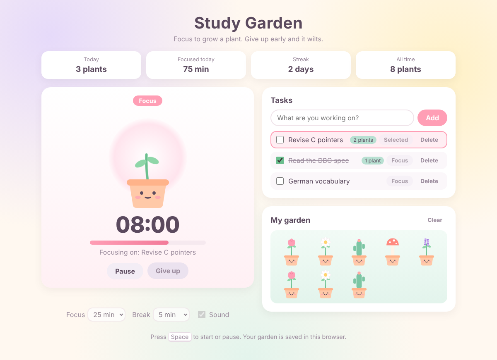

# Study Garden


A small focus timer built with React. Every focus session grows a plant in a little pot: it starts as a seed, sprouts, grows leaves and a bud, and blooms when the session ends. Finished plants are added to your garden. Give up early and the plant wilts.

**Live demo:** https://hijabh.github.io/study-garden/



## Features

- Focus and break timer (15, 25, 45 or 50 minutes of focus; 5, 10 or 15 minutes of break)
- Five hand-drawn SVG plants (tulip, daisy, cactus, mushroom, lavender) that grow in four stages and wilt if you give up
- A task list: pick a task before you start, and each finished session is counted on it
- A garden of everything you have grown, with today's plants, minutes, your daily streak and the all-time total
- A soft chime at the end of a session (can be turned off)
- The garden, tasks and settings are saved in the browser with `localStorage`
- Keyboard shortcut: <kbd>Space</kbd> starts and pauses
- Works on phones, respects "reduce motion", and the timer, buttons and messages are labelled for screen readers

## Run it

Requires Node.js 20 or newer.

```bash
npm install
npm run dev       # development server at http://localhost:5173
npm test          # run the tests
npm run build     # production build in dist/
```

## How it works

| Path | Responsibility |
| --- | --- |
| `src/logic/timer.js` | Pure functions for the timer: start, pause, tick, give up, growth stage |
| `src/logic/garden.js` | Adding plants and calculating today's total and the streak |
| `src/hooks/useTimer.js` | Connects the timer logic to React and ticks while running |
| `src/hooks/useLocalStorage.js` | State that is saved in the browser, safe when storage is blocked |
| `src/components/` | `Plant` (SVG), `TimerCard`, `TaskList`, `Garden`, `Stats` |
| `src/App.jsx` | Puts it together: modes, tasks, keyboard shortcut, messages |

- **The timer counts towards a fixed end time** instead of subtracting one second per tick. Browsers slow down timers in background tabs, so counting ticks would drift; this way 25 minutes stays 25 minutes even if you switch tabs.
- **The logic is separate from the UI.** The timer and garden rules are plain JavaScript functions with no React in them, so they are easy to test.
- **No UI library and no images.** The plants are SVG drawn in code, and the styling is plain CSS with custom properties.

## Tests

26 tests with Vitest and React Testing Library. The timer and garden functions are tested directly; the app tests use fake timers to run a full 25-minute session in milliseconds and check that the plant grows, blooms and lands in the garden, that giving up wilts it, that pausing keeps the time, that tasks count their sessions, and that everything is still there after a reload.

GitHub Actions runs the tests on every push and then publishes the build to GitHub Pages.

## License

[MIT](LICENSE)
